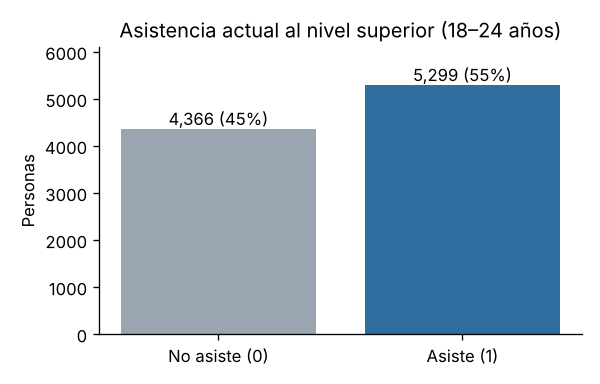

# Informe técnico del dataset

**Proyecto:** Predicción de la asistencia al nivel superior en jóvenes a partir de la EPH (INDEC)

**Autora:** Liliana Elizabeth Iñigo

**Materia:** Aprendizaje Automático

**Docente:** Nicolás Caballero

Este documento describe el dataset del proyecto: de dónde provienen los datos, cómo se construyó, cuántos registros tiene, qué variables contiene, de qué tipo son y qué representa cada una. También documenta las decisiones tomadas sobre registros, categorías y faltantes.

El trabajo con los datos (código y resultados) está en las notebooks:

| Notebook | Contenido |
|---|---|
| [`1.0-lei-carga-y-construccion-dataset`](../notebooks/1.0-lei-carga-y-construccion-dataset.ipynb) | Carga de las bases originales y construcción del dataset |
| [`2.0-lei-analisis-exploratorio`](../notebooks/2.0-lei-analisis-exploratorio.ipynb) | Análisis exploratorio de datos (EDA) |
| [`3.0-lei-preprocesamiento`](../notebooks/3.0-lei-preprocesamiento.ipynb) | Limpieza, transformaciones, codificación y escalado |

## Contenido

1. [Origen de los datos](#1-origen-de-los-datos)
2. [Archivos originales](#2-archivos-originales)
3. [Construcción del dataset](#3-construcción-del-dataset)
4. [Descripción del dataset final](#4-descripción-del-dataset-final)
5. [Diccionario de datos](#5-diccionario-de-datos)
6. [Variables excluidas por fuga de información](#6-variables-excluidas-por-fuga-de-información)
7. [Decisiones de preparación](#7-decisiones-de-preparación)
8. [Archivos generados](#8-archivos-generados)
9. [Limitaciones](#9-limitaciones)

---

## 1. Origen de los datos

| | |
|---|---|
| **Fuente** | Encuesta Permanente de Hogares (EPH), modalidad continua – Instituto Nacional de Estadística y Censos (INDEC) |
| **Sitio de descarga** | https://www.indec.gob.ar/indec/web/Institucional-Indec-BasesDeDatos |
| **Trimestres** | 2.º, 3.º y 4.º trimestre de 2025 y 1.er trimestre de 2026 (los cuatro más recientes publicados al momento de la descarga) |
| **Fecha de descarga** | 22 de octubre de 2026 |
| **Cómo se recopilan los datos** | Encuesta por muestreo a hogares, realizada por el INDEC en forma continua a lo largo del año. Cada hogar se entrevista en varios trimestres (panel rotativo) |
| **Cobertura geográfica** | 31 aglomerados urbanos del país (32 códigos de `AGLOMERADO`, porque el Gran Buenos Aires se divide en Ciudad de Buenos Aires y partidos del conurbano). No incluye población rural |
| **Formato** | Archivos de texto separados por punto y coma (`;`); por cada trimestre, una base de **personas** y una de **hogares** |
| **Uso** | Datos públicos del INDEC; se cita la fuente |
| **Documentación oficial** | Diseño de registro y estructura de las bases de la EPH, disponible en el mismo sitio de descarga |

Como la EPH cubre solo aglomerados urbanos, los resultados del proyecto se refieren a los jóvenes que viven en esos aglomerados y no a toda la población joven del país.

## 2. Archivos originales

Se guardan sin modificar en [`data/raw/`](../data/raw/).

| Archivo | Contenido | Filas | Columnas |
|---|---|---:|---:|
| `usu_individual_T225.txt` | Personas, 2T 2025 | 46.086 | 235 |
| `usu_individual_T325.txt` | Personas, 3T 2025 | 44.946 | 235 |
| `usu_individual_T425.txt` | Personas, 4T 2025 | 43.703 | 235 |
| `usu_individual_T126.txt` | Personas, 1T 2026 | 43.739 | 234 |
| `usu_hogar_T225.txt` | Hogares, 2T 2025 | 16.169 | 98 |
| `usu_hogar_T325.txt` | Hogares, 3T 2025 | 15.860 | 98 |
| `usu_hogar_T425.txt` | Hogares, 4T 2025 | 15.534 | 98 |
| `usu_hogar_T126.txt` | Hogares, 1T 2026 | 15.447 | 98 |

En total hay **178.474 registros de personas** y **63.010 de hogares**. La base de personas del 1T 2026 tiene una columna menos: no trae `CAT_INAC` (categoría de inactividad), por un cambio en el diseño de registro del INDEC. No afecta al proyecto porque esa variable se excluye (sección 6).

## 3. Construcción del dataset

Detalle con código y resultados en la notebook `1.0`. El mismo proceso se puede reproducir con el script [`asistencia_superior/dataset.py`](../asistencia_superior/dataset.py).

### 3.1 Vinculación persona – hogar – jefe o jefa

- **Persona con su hogar:** las dos bases comparten `CODUSU` (vivienda) y `NRO_HOGAR` (hogar dentro de la vivienda); como hay cuatro trimestres, la clave se completa con `ANO4` y `TRIMESTRE`. Coincidencia: 100 %.
- **Persona con el jefe o jefa de hogar:** dentro del mismo hogar, es la persona con `CH03 = 1`. Todos los hogares tienen exactamente un jefe/a. De esa persona se toman nivel educativo, sexo y condición de actividad.
- Si el joven es **él mismo jefe/a o cónyuge** (`CH03` = 1 o 2), la "educación del jefe/a" sería su propia educación o la de su pareja, que dice mucho sobre la respuesta. En esos casos los datos del jefe/a quedan vacíos y se marca `es_jefe_o_conyuge = 1`.

### 3.2 Población de estudio

Jóvenes de **18 a 24 años** (`CH06`) que **terminaron el secundario y no completaron un estudio superior**, según `NIVEL_ED`:

| `NIVEL_ED` | Significado | ¿Se incluye? | Jóvenes 18–24 |
|---|---|---|---:|
| 1, 2, 3, 7 | Primaria incompleta o completa, secundaria incompleta, sin instrucción | No: no terminaron el secundario | 5.446 |
| **4** | Secundario completo | **Sí** | 5.609 |
| **5** | Superior universitario incompleto | **Sí** | 8.274 |
| 6 | Superior universitario completo | No: ya terminaron un estudio superior | 502 |

Se incluye el código 5 porque quien terminó el secundario y **está cursando** el nivel superior figura con `NIVEL_ED = 5`, no con 4. Se excluye el 6 porque no asistir actualmente no significa que no hayan accedido. Resultado: **13.883 observaciones** (3.726 en 2T 2025, 3.437 en 3T 2025, 3.223 en 4T 2025 y 3.497 en 1T 2026).

### 3.3 Variable objetivo

`asiste_superior` surge de dos preguntas de la encuesta:

- `CH10`: ¿asiste o asistió a algún establecimiento educativo? (1 = asiste · 2 = no asiste, pero asistió · 3 = nunca asistió)
- `CH12`: ¿cuál es el nivel más alto que cursa o cursó? (6 = terciario · 7 = universitario · 8 = posgrado, entre otros)

| Valor | Condición | Significado |
|---|---|---|
| `1` | `CH10 = 1` y `CH12` ∈ {6, 7, 8} | Asiste actualmente al nivel superior |
| `0` | Cualquier otro caso | No asiste actualmente al nivel superior |

`CH12` también registra niveles cursados en el pasado, por eso se interpreta siempre junto con `CH10`. La variable describe la situación **en el momento de la encuesta**. Hay 3 registros sin dato (`CH10 = 1` con `CH12 = 99`, y `CH10` = 0 o 9) que quedan en la clase 0; por ser 3 de 13.883 no alteran los resultados.

### 3.4 Panel: una fila por persona

La EPH vuelve a encuestar a los mismos hogares en trimestres sucesivos. Una persona se identifica con `CODUSU` + `NRO_HOGAR` + `COMPONENTE`. De las 13.883 observaciones, 5.447 personas aparecen una vez y 4.218 aparecen dos veces. Se conserva **la observación más reciente de cada persona**: **9.665 personas**.

## 4. Descripción del dataset final

Archivo: [`data/processed/eph_jovenes_asistencia_superior.csv`](../data/processed/eph_jovenes_asistencia_superior.csv)

| | |
|---|---|
| **Unidad de análisis (cada fila)** | Un joven de 18 a 24 años con secundario completo y sin estudio superior terminado, con su situación y la de su hogar en el trimestre en que fue encuestado |
| **Instancias** | 9.665 personas |
| **Columnas** | 26: 5 de identificación y diseño muestral, 1 variable objetivo y 20 predictoras candidatas |
| **Clases** | `asiste_superior = 1`: 5.299 (54,8 %) · `asiste_superior = 0`: 4.366 (45,2 %) |
| **Personas repetidas** | 0 |
| **Distribución por trimestre (observación conservada)** | 2T 2025: 1.896 · 3T 2025: 2.151 · 4T 2025: 2.121 · 1T 2026: 3.497 |

### Tipos de datos y faltantes

| Columna | Tipo en el archivo | Tipo de variable | Rol | Faltantes |
|---|---|---|---|---:|
| `codusu` | texto | identificador | identificación | 0 |
| `nro_hogar`, `componente` | entero | identificador | identificación | 0 |
| `trimestre` | texto | identificador | identificación | 0 |
| `ponderador` | entero | numérica discreta | diseño muestral (no predictora) | 0 |
| `asiste_superior` | entero | binaria | **variable objetivo** | 0 |
| `sexo` | entero (código) | categórica binaria | predictora | 0 |
| `edad` | entero | numérica discreta | predictora | 0 |
| `parentesco_jefe` | entero (código) | categórica nominal | predictora | 0 |
| `es_jefe_o_conyuge` | entero | binaria | predictora | 0 |
| `estado_civil` | entero (código) | categórica nominal | predictora | 0 |
| `cobertura_salud` | decimal (código) | categórica nominal | predictora | 0 |
| `lugar_nacimiento` | entero (código) | categórica nominal | predictora | 0 |
| `condicion_actividad` | entero (código) | categórica nominal | predictora (zona gris) | 0 |
| `personas_hogar` | entero | numérica discreta | predictora | 0 |
| `menores_10_hogar` | entero | numérica discreta | predictora | 0 |
| `personas_por_ambiente` | decimal | numérica continua | predictora | 4 |
| `tipo_vivienda` | entero (código) | categórica nominal | predictora | 0 |
| `tenencia_vivienda` | entero (código) | categórica nominal | predictora | 0 |
| `ingreso_resto_hogar_pc` | decimal (pesos) | numérica continua | predictora | 2.784 |
| `ingresos_sin_respuesta` | entero | binaria | predictora | 0 |
| `jefe_nivel_educativo` | decimal (código) | categórica | predictora | 1.337 |
| `jefe_sexo` | decimal (código) | categórica binaria | predictora | 1.337 |
| `jefe_condicion_actividad` | decimal (código) | categórica nominal | predictora | 1.337 |
| `region` | entero (código) | categórica nominal | predictora | 0 |
| `aglomerado` | entero (código) | categórica nominal | predictora | 0 |

Varias columnas están guardadas como números pero son **categóricas**: los números son códigos de la EPH, no cantidades. Las que figuran como "decimal (código)" lo son solo porque tienen celdas vacías.

**Por qué faltan datos:**
- `ingreso_resto_hogar_pc` (28,8 %): el hogar no respondió ingresos. En la EPH esos hogares figuran con `ITF = 0` y `DECCFR = 12`; no son hogares sin ingresos, por eso se dejan vacíos y se marcan con `ingresos_sin_respuesta = 1`.
- `jefe_nivel_educativo`, `jefe_sexo`, `jefe_condicion_actividad` (13,8 %): jóvenes que son jefe/a o cónyuge. No es un dato perdido: la variable **no aplica** (sección 3.1).
- `personas_por_ambiente` (4 casos): hogares sin dato de cantidad de ambientes.

## 5. Diccionario de datos

Los códigos provienen del diseño de registro de la EPH continua (INDEC).

### Identificación y diseño muestral

| Columna | Origen EPH | Descripción |
|---|---|---|
| `codusu` | `CODUSU` | Código de la vivienda |
| `nro_hogar` | `NRO_HOGAR` | Número de hogar dentro de la vivienda |
| `componente` | `COMPONENTE` | Número de la persona dentro del hogar. `codusu` + `nro_hogar` + `componente` identifican a la persona |
| `trimestre` | `ANO4` + `TRIMESTRE` | Trimestre de la observación conservada (`2025T2`, `2025T3`, `2025T4`, `2026T1`) |
| `ponderador` | `PONDERA` | Factor de expansión: cuántas personas de la población representa cada caso |

### Variable objetivo

| Columna | Construcción | Valores |
|---|---|---|
| `asiste_superior` | `CH10 == 1` y `CH12` ∈ {6, 7, 8} | 1 = asiste actualmente al nivel superior · 0 = no asiste actualmente |

### Variables del joven

| Columna | Origen EPH | Códigos |
|---|---|---|
| `sexo` | `CH04` | 1 Varón · 2 Mujer |
| `edad` | `CH06` | Años cumplidos (18 a 24) |
| `parentesco_jefe` | `CH03` | 1 Jefe/a · 2 Cónyuge/pareja · 3 Hijo/a o hijastro/a · 4 Yerno/nuera · 5 Nieto/a · 6 Madre/padre · 7 Suegro/a · 8 Hermano/a · 9 Otros familiares · 10 No familiares |
| `es_jefe_o_conyuge` | derivada de `CH03` | 1 = el joven es jefe/a o cónyuge del jefe/a |
| `estado_civil` | `CH07` | 1 Unido/a · 2 Casado/a · 3 Separado/a o divorciado/a · 4 Viudo/a · 5 Soltero/a · 9 Ns/Nr |
| `cobertura_salud` | `CH08` | 1 Obra social · 2 Mutual, prepaga o servicio de emergencia · 3 Planes y seguros públicos · 4 No paga ni le descuentan · 9 Ns/Nr · 12, 13, 23 combinaciones de las anteriores |
| `lugar_nacimiento` | `CH15` | 1 En esta localidad · 2 En otra localidad de esta provincia · 3 En otra provincia · 4 En un país limítrofe · 5 En otro país · 9 Ns/Nr |
| `condicion_actividad` | `ESTADO` | 0 Entrevista individual no realizada · 1 Ocupado/a · 2 Desocupado/a · 3 Inactivo/a |

### Variables del hogar

| Columna | Origen EPH | Descripción / códigos |
|---|---|---|
| `personas_hogar` | `IX_TOT` (base hogares) | Cantidad de miembros del hogar |
| `menores_10_hogar` | `IX_MEN10` (base hogares) | Cantidad de miembros menores de 10 años |
| `personas_por_ambiente` | `IX_TOT / II1` | Hacinamiento: personas por ambiente de uso exclusivo del hogar |
| `tipo_vivienda` | `IV1` (base hogares) | 1 Casa · 2 Departamento · 3 Pieza de inquilinato · 4 Pieza en hotel o pensión · 5 Local no construido para habitación · 6 Otros |
| `tenencia_vivienda` | `II7` (base hogares) | 1 Propietario de la vivienda y el terreno · 2 Propietario solo de la vivienda · 3 Inquilino · 4 Ocupante por pago de impuestos/expensas · 5 Ocupante en relación de dependencia · 6 Ocupante gratuito (con permiso) · 7 Ocupante de hecho · 8 En sucesión · 9 Otra situación · 0 Sin dato |
| `ingreso_resto_hogar_pc` | `(ITF − P47T) / (IX_TOT − 1)` | Ingreso per cápita del resto del hogar, en pesos corrientes, **sin los ingresos propios del joven**. Vacío si el hogar no respondió ingresos. 0 si el joven vive solo |
| `ingresos_sin_respuesta` | `DECCFR == 12` | 1 = el hogar no respondió ingresos |

### Variables del jefe o jefa de hogar

Se toman de la persona del mismo hogar con `CH03 = 1`. Quedan vacías si el joven es jefe/a o cónyuge.

| Columna | Origen EPH | Códigos |
|---|---|---|
| `jefe_nivel_educativo` | `NIVEL_ED` del jefe/a | 1 Primaria incompleta · 2 Primaria completa · 3 Secundaria incompleta · 4 Secundaria completa · 5 Superior universitario incompleto · 6 Superior universitario completo · 7 Sin instrucción |
| `jefe_sexo` | `CH04` del jefe/a | 1 Varón · 2 Mujer |
| `jefe_condicion_actividad` | `ESTADO` del jefe/a | 0 Entrevista individual no realizada · 1 Ocupado/a · 2 Desocupado/a · 3 Inactivo/a |

### Ubicación

| Columna | Origen EPH | Códigos |
|---|---|---|
| `region` | `REGION` | 1 Gran Buenos Aires · 40 Noroeste · 41 Noreste · 42 Cuyo · 43 Pampeana · 44 Patagonia |
| `aglomerado` | `AGLOMERADO` | 32 códigos (tabla siguiente) |

| Código | Aglomerado | Código | Aglomerado |
|---|---|---|---|
| 2 | Gran La Plata | 22 | Gran Catamarca |
| 3 | Bahía Blanca – Cerri | 23 | Gran Salta |
| 4 | Gran Rosario | 25 | La Rioja |
| 5 | Gran Santa Fe | 26 | Gran San Luis |
| 6 | Gran Paraná | 27 | Gran San Juan |
| 7 | Posadas | 29 | Gran Tucumán – Tafí Viejo |
| 8 | Gran Resistencia | 30 | Santa Rosa – Toay |
| 9 | Comodoro Rivadavia – Rada Tilly | 31 | Ushuaia – Río Grande |
| 10 | Gran Mendoza | 32 | Ciudad Autónoma de Buenos Aires |
| 12 | Corrientes | 33 | Partidos del GBA |
| 13 | Gran Córdoba | 34 | Mar del Plata |
| 14 | Concordia | 36 | Río Cuarto |
| 15 | Formosa | 38 | San Nicolás – Villa Constitución |
| 17 | Neuquén – Plottier | 91 | Rawson – Trelew |
| 18 | Santiago del Estero – La Banda | 93 | Viedma – Carmen de Patagones |
| 19 | Jujuy – Palpalá | | |
| 20 | Río Gallegos | | |

## 6. Variables excluidas por fuga de información

Una variable "filtra" la respuesta cuando contiene, directa o indirectamente, la información que se quiere predecir. La revisión con datos está en la sección 7 de la notebook `1.0`.

| Variable EPH | Qué muestran los datos | Decisión |
|---|---|---|
| `CH10`, `CH12` | Construyen la variable objetivo | Excluidas |
| `NIVEL_ED` (del joven) | Con 4 nadie asiste; con 5 asiste el 94 %: es casi la respuesta misma | Solo se usa para delimitar la población |
| `CH11`, `CH13`, `CH14` | Tipo de establecimiento al que asiste, si finalizó el nivel, último año aprobado | Excluidas (indicadores educativos derivados) |
| `CAT_INAC` | La categoría 3 "estudiante" corresponde a quienes asisten (4.342 de 4.343); además no existe en 1T 2026 | Excluida |
| `V11_01_M`, `V11_02_M` | Montos de beca de estudio del joven: el 95 % de quienes la cobran asiste | Excluidas |
| `V12_M` | Cuota alimentaria: el 91 % de quienes la reciben asiste | Excluida |
| `P47T`, `ITF`, `IPCF` y deciles | Incluyen los montos anteriores | Reemplazadas por `ingreso_resto_hogar_pc` |

> Los significados de los códigos de ingresos V11 y V12 deben confirmarse con el diseño de registro 2025–2026 del INDEC, que cambió respecto de años anteriores.

**Zona gris — `condicion_actividad`:** no es un indicador educativo, pero se registra al mismo tiempo que la asistencia y en parte puede ser consecuencia de estudiar (los inactivos asisten un 76 %, frente a alrededor de 30 % de ocupados y desocupados). Se conserva y queda señalada. Por la misma razón se señalan, como hipótesis, ser jefe de hogar joven, vivir solo, ser inquilino o haber nacido en otra localidad: podrían reflejar en parte a jóvenes que se mudaron para estudiar (ver notebook `2.0`, sección 4).

## 7. Decisiones de preparación

Detalle con código y resultados en la notebook `3.0`. Se resumen aquí porque algunas justificaciones son extensas.

### 7.1 Variables que no entran a la matriz de entrada

| Variable | Motivo |
|---|---|
| `codusu`, `nro_hogar`, `componente` | Identifican, no miden |
| `ponderador` | Factor de expansión de la encuesta, no una característica del joven. El análisis se hace sin ponderar: el porcentaje que asiste ponderado (53,2 %) es parecido al de la muestra (54,8 %) |
| `trimestre` | Se usa solo para separar entrenamiento y prueba |
| `es_jefe_o_conyuge` | Su información queda contenida en `parentesco_jefe` |
| `aglomerado` | 32 categorías, varias con pocos casos, y repite la información de `region` |

### 7.2 Recodificación de categorías

Se aplica antes de separar entrenamiento y prueba, porque son reglas sobre el significado de los códigos y no dependen de la distribución de los datos.

| Variable | Agrupamiento | Justificación |
|---|---|---|
| `parentesco_jefe` | jefe · cónyuge · hijo · nieto · otro familiar (4, 6, 7, 8, 9) · no familiar | Las categorías 4, 6, 7, 8 y 9 tienen pocos casos y comparten la situación de "otro familiar" |
| `estado_civil` | unido o casado · separado/divorciado/viudo · soltero; Ns/Nr → faltante | Separado/a y viudo/a tienen 40 casos entre ambos |
| `cobertura_salud` | obra social o prepaga (1, 2, 12, 13, 23) · solo plan público (3) · sin cobertura (4); Ns/Nr → faltante | Las combinaciones tienen muy pocos casos e incluyen cobertura contributiva |
| `lugar_nacimiento` | esta localidad · otra localidad de la provincia · otra provincia · otro país (4, 5); Ns/Nr → faltante | País limítrofe y otro país tienen alrededor de 80 casos cada uno |
| `condicion_actividad`, `jefe_condicion_actividad` | ocupado · desocupado · inactivo; sin entrevista individual → faltante | El código 0 no es una condición de actividad |
| `tipo_vivienda` | casa · departamento · otro (3 a 6) | Los otros tipos suman 29 casos |
| `tenencia_vivienda` | propietario (1, 2) · inquilino · otra situación (4 a 9); sin dato → faltante | Varias situaciones de ocupación tienen menos de 50 casos |
| `jefe_nivel_educativo` | sin instrucción o primaria incompleta (7, 1) · primaria completa · secundaria incompleta · secundaria completa · superior incompleto · superior completo · no aplica | "Sin instrucción" tiene 53 casos. Se trata como nominal (one-hot) porque la categoría "no aplica" no tiene lugar en el orden y así no se imponen distancias iguales entre niveles |
| Datos del jefe/a de jóvenes jefe/a o cónyuge | → "no aplica" | No es un dato perdido: la variable no corresponde. Queda como categoría propia y no se imputa |
| `sexo` | `sexo_mujer` (1 = mujer, 0 = varón) | Codificación binaria explícita |

### 7.3 Ingreso

- Es muy asimétrico (asimetría ≈ 12) y tiene 360 casos por encima de 1,5 veces el rango intercuartílico. Son valores posibles (hogares de ingresos altos), no errores: **no se eliminan**. Se aplica **log(1 + x)**, que vuelve la distribución casi simétrica.
- 675 jóvenes tienen ingreso del resto del hogar **igual a 0**; 540 de ellos viven solos (no hay "resto del hogar"). No es un ingreso bajo sino otra situación, y asisten un 70 %. Se crea el indicador `ingreso_resto_cero` y, para esos casos, el monto se deja vacío y se imputa como los demás; así el 0 no queda como un valor extremo después del logaritmo.
- Los faltantes (hogares sin respuesta y casos con 0) se imputan con la **mediana del entrenamiento**. Imputar no recupera el dato verdadero y concentra muchos casos en un mismo valor; por eso se conservan los indicadores `ingresos_sin_respuesta` e `ingreso_resto_cero`. El faltante no es totalmente al azar: quienes no respondieron asisten un poco menos (52,7 % frente a 55,7 %).

### 7.4 Partición entrenamiento / prueba

**Temporal:** entrenamiento con los trimestres de 2025 (6.168 jóvenes, 55,6 % asiste) y prueba con el 1T 2026 (3.497 jóvenes, 53,5 % asiste). Respeta el orden en el tiempo (aprender con datos pasados y comprobar con datos más nuevos, como en el uso real con cada nueva EPH) y, como hay una fila por persona, ningún joven queda en los dos conjuntos.

### 7.5 Imputación, codificación y escalado

Todos los parámetros se aprenden **solo con el entrenamiento** y se aplican sin cambios a la prueba, para que la prueba no participe de la preparación.

| Grupo | Pasos |
|---|---|
| Numéricas (edad, personas del hogar, menores de 10, personas por ambiente) | Mediana → estandarización (media 0, desvío 1) |
| Ingreso | log(1 + x) → mediana → estandarización |
| Binarias (sexo_mujer, ingresos_sin_respuesta, ingreso_resto_cero) | Sin cambios |
| Nominales | Categoría más frecuente → one-hot |

Se preparan dos variantes: **escalada**, para métodos sensibles a la escala (regresión logística, KNN, SVM), y **sin escalar**, para árboles de decisión, que trabajan con umbrales. Resultado: 19 variables de entrada que se convierten en 53 columnas después del one-hot.

## 8. Archivos generados

| Archivo | Contenido | Filas × columnas |
|---|---|---|
| [`data/interim/eph_jovenes_18a24_todas_las_observaciones.csv`](../data/interim/eph_jovenes_18a24_todas_las_observaciones.csv) | Población de estudio con todas las observaciones del panel e incluye `CH10`, `CH12` y `NIVEL_ED` para verificar la variable objetivo | 13.883 × 36 |
| [`data/processed/eph_jovenes_asistencia_superior.csv`](../data/processed/eph_jovenes_asistencia_superior.csv) | Dataset final, una fila por persona (descripto en las secciones 4 y 5) | 9.665 × 26 |
| [`data/processed/matriz_preparada_escalada.csv`](../data/processed/matriz_preparada_escalada.csv) | Matriz de entrada preparada, con escalado; incluye `particion` y `asiste_superior` | 9.665 × 55 |
| [`data/processed/matriz_preparada_sin_escalar.csv`](../data/processed/matriz_preparada_sin_escalar.csv) | Matriz de entrada preparada, sin escalado; incluye `particion` y `asiste_superior` | 9.665 × 55 |

## 9. Limitaciones

- **Cobertura:** solo aglomerados urbanos; no representa a la población rural.
- **Momento de la medición:** la variable objetivo describe la asistencia en el momento de la encuesta, no una decisión futura.
- **Asociación no es causalidad:** las relaciones observadas entre las variables y la asistencia no prueban que una cause la otra.
- **Variables de zona gris:** algunas características (condición de actividad, vivir solo, haber nacido en otra localidad) podrían ser en parte consecuencia de estudiar.
- **Ingresos:** casi 3 de cada 10 hogares no respondieron ingresos; la imputación no recupera esos datos.
- **Cambios de diseño:** el 1T 2026 cambió el diseño de registro de la EPH; los códigos de ingresos deben confirmarse con la documentación oficial.
