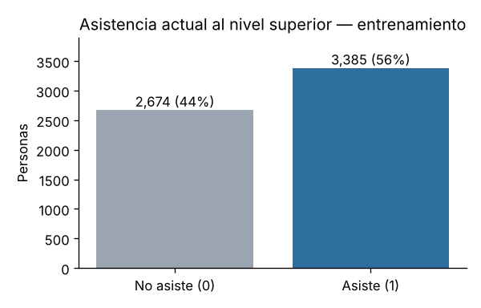

# Informe técnico del dataset

**Proyecto:** Predicción de la asistencia actual al nivel superior en jóvenes de 18 a 24 años con secundario completo (EPH – INDEC)

**Autora:** Liliana Elizabeth Iñigo

**Materia:** Aprendizaje Automático

**Docente:** Nicolás Caballero

Este documento describe el dataset del proyecto: de dónde provienen los datos, cómo se construyó, cuántos registros tiene, qué variables contiene, de qué tipo son y qué representa cada una. También documenta las decisiones tomadas sobre registros, categorías y faltantes.

El trabajo con los datos (código y resultados) está en las notebooks:

| Notebook | Contenido |
|---|---|
| [`1.0-lei-carga-y-construccion-dataset`](../notebooks/1.0-lei-carga-y-construccion-dataset.ipynb) | Carga de las bases originales y construcción del dataset |
| [`2.0-lei-analisis-exploratorio`](../notebooks/2.0-lei-analisis-exploratorio.ipynb) | Análisis exploratorio de datos (EDA), solo con el conjunto de entrenamiento |
| [`3.0-lei-preprocesamiento`](../notebooks/3.0-lei-preprocesamiento.ipynb) | Limpieza, transformaciones, codificación y escalado |

## Contenido

1. [Origen de los datos](#1-origen-de-los-datos)
2. [Archivos originales](#2-archivos-originales)
3. [Construcción del dataset](#3-construcción-del-dataset)
4. [Descripción del dataset final](#4-descripción-del-dataset-final)
5. [Diccionario de datos](#5-diccionario-de-datos)
6. [Variables excluidas por fuga de información](#6-variables-excluidas-por-fuga-de-información)
7. [Decisiones de preparación](#7-decisiones-de-preparación)
8. [Archivos generados](#8-archivos-generados)
9. [Alcance y representatividad](#9-alcance-y-representatividad)
10. [Limitaciones](#10-limitaciones)

Los ajustes realizados a partir de la devolución de la segunda entrega están resumidos en [`ajustes_devolucion_entrega2.md`](ajustes_devolucion_entrega2.md).

---

## 1. Origen de los datos

| | |
|---|---|
| **Fuente** | Encuesta Permanente de Hogares (EPH), modalidad continua – Instituto Nacional de Estadística y Censos (INDEC) |
| **Sitio de descarga** | https://www.indec.gob.ar/indec/web/Institucional-Indec-BasesDeDatos |
| **Trimestres** | 2.º, 3.º y 4.º trimestre de 2025 y 1.er trimestre de 2026 (los cuatro más recientes publicados al momento de la descarga) |
| **Fecha de descarga** | 22 de octubre de 2026 |
| **Cómo se recopilan los datos** | Encuesta por muestreo a hogares, realizada por el INDEC en forma continua a lo largo del año. Cada hogar se entrevista en varios trimestres (panel rotativo) |
| **Cobertura geográfica** | 31 aglomerados urbanos del país (32 códigos de `AGLOMERADO`, porque el Gran Buenos Aires se divide en Ciudad de Buenos Aires y partidos del conurbano). No incluye población rural |
| **Formato** | Archivos de texto separados por punto y coma (`;`); por cada trimestre, una base de **personas** y una de **hogares** |
| **Uso** | Datos públicos del INDEC; se cita la fuente |
| **Documentación oficial** | Diseño de registro de las bases de usuarios de la EPH, 1.er trimestre de 2025: https://www.indec.gob.ar/ftp/cuadros/menusuperior/eph/EPH_registro_1T2025.pdf |

Como la EPH cubre solo aglomerados urbanos, los resultados del proyecto se refieren a los jóvenes que viven en esos aglomerados y no a toda la población joven del país.

## 2. Archivos originales

Se guardan sin modificar en [`data/raw/`](../data/raw/).

| Archivo | Contenido | Filas | Columnas |
|---|---|---:|---:|
| `usu_individual_T225.txt` | Personas, 2T 2025 | 46.086 | 235 |
| `usu_individual_T325.txt` | Personas, 3T 2025 | 44.946 | 235 |
| `usu_individual_T425.txt` | Personas, 4T 2025 | 43.703 | 235 |
| `usu_individual_T126.txt` | Personas, 1T 2026 | 43.739 | 234 |
| `usu_hogar_T225.txt` | Hogares, 2T 2025 | 16.169 | 98 |
| `usu_hogar_T325.txt` | Hogares, 3T 2025 | 15.860 | 98 |
| `usu_hogar_T425.txt` | Hogares, 4T 2025 | 15.534 | 98 |
| `usu_hogar_T126.txt` | Hogares, 1T 2026 | 15.447 | 98 |

En total hay **178.474 registros de personas** y **63.010 de hogares**. Los montos con decimales usan **coma decimal** (por eso se leen con `decimal=","`). La base de personas del 1T 2026 tiene una columna menos: no trae `CAT_INAC` (categoría de inactividad), por un cambio en el diseño de registro del INDEC. No afecta al proyecto porque esa variable se excluye (sección 6).

## 3. Construcción del dataset

Detalle con código y resultados en la notebook `1.0`. El mismo proceso se puede reproducir con el script [`asistencia_superior/dataset.py`](../asistencia_superior/dataset.py); los dos generan el mismo archivo.

Las decisiones de esta etapa se basan en **reglas sobre el significado de los códigos** (diseño de registro del INDEC) o en la estructura de la encuesta. Ninguna se toma a partir de frecuencias o relaciones observadas en los datos de prueba.

### 3.1 Vinculación persona – hogar – jefe o jefa

- **Persona con su hogar:** las dos bases comparten `CODUSU` (vivienda) y `NRO_HOGAR` (hogar dentro de la vivienda); como hay cuatro trimestres, la clave se completa con `ANO4` y `TRIMESTRE`. Coincidencia: 100 %.
- **Persona con el jefe o jefa de hogar:** dentro del mismo hogar, es la persona con `CH03 = 1`. Todos los hogares tienen exactamente un jefe/a. De esa persona se toman nivel educativo, sexo y condición de actividad.
- Si el joven es **él mismo el jefe/a** (`CH03 = 1`), la "educación del jefe/a" sería su propia educación, que contiene la respuesta. En ese caso los datos del jefe/a quedan vacíos (no aplica) y se marca `es_jefe_hogar = 1`.
- Si el joven es **cónyuge** del jefe/a (`CH03 = 2`), los datos del jefe/a corresponden a **otra persona** (su pareja) y se conservan como para cualquier otro integrante.

### 3.2 Población de estudio

Jóvenes de **18 a 24 años** (`CH06`) que **terminaron el secundario y no completaron un estudio superior**, según `NIVEL_ED`:

| `NIVEL_ED` | Significado | ¿Se incluye? | Jóvenes 18–24 |
|---|---|---|---:|
| 1, 2, 3, 7 | Primaria incompleta o completa, secundaria incompleta, sin instrucción | No: no terminaron el secundario | 5.446 |
| **4** | Secundario completo | **Sí** | 5.609 |
| **5** | Superior universitario incompleto | **Sí** | 8.274 |
| 6 | Superior universitario completo | No: ya terminaron un estudio superior | 502 |

Se incluye el código 5 porque quien terminó el secundario y **está cursando** el nivel superior figura con `NIVEL_ED = 5`, no con 4. Se excluye el 6 porque no asistir actualmente no significa que no hayan accedido. Resultado: **13.883 observaciones** (3.726 en 2T 2025, 3.437 en 3T 2025, 3.223 en 4T 2025 y 3.497 en 1T 2026).

### 3.3 Variable objetivo y respuestas desconocidas

`asiste_superior` surge de dos preguntas de la encuesta:

- `CH10`: ¿asiste o asistió a algún establecimiento educativo? (1 = asiste · 2 = no asiste, pero asistió · 3 = nunca asistió)
- `CH12`: ¿cuál es el nivel más alto que cursa o cursó? (6 = terciario · 7 = universitario · 8 = posgrado, entre otros)

| Valor | Condición | Significado |
|---|---|---|
| `1` | `CH10 = 1` y `CH12` ∈ {6, 7, 8} | Asiste actualmente al nivel superior |
| `0` | `CH10` = 2 o 3, o `CH10 = 1` con otro nivel válido | No asiste actualmente al nivel superior |
| desconocida | `CH10` sin código válido (0 o 9), o `CH10 = 1` con `CH12 = 99` | No puede determinarse: **se excluye** |

`CH12` también registra niveles cursados en el pasado, por eso se interpreta siempre junto con `CH10`. La variable describe la situación **en el momento de la encuesta**.

**Respuestas desconocidas:** hay 3 observaciones (todas de 2T 2025) cuya asistencia no puede determinarse. Desconocer la respuesta no equivale a una respuesta negativa, por eso no se les asigna la clase 0 y se **excluyen del conjunto supervisado**. No se las resuelve con otra información porque la encuesta no ofrece otro dato válido sobre la asistencia. Alternativas como el aprendizaje semisupervisado no se justifican con 3 casos sin etiqueta frente a más de 9.000 etiquetados, pero la exclusión no se fundamenta en que sean pocos sino en que la etiqueta es desconocida.

### 3.4 Panel: una fila por persona

La EPH vuelve a encuestar a los mismos hogares en trimestres sucesivos. Una persona se identifica con `CODUSU` + `NRO_HOGAR` + `COMPONENTE`. De las 13.883 observaciones, 5.447 personas aparecen una vez y 4.218 aparecen dos veces (9.665 personas distintas).

Se conserva **la observación más reciente con respuesta conocida de cada persona**. De las 3 observaciones con respuesta desconocida, una pertenece a una persona que tiene otra observación válida (se usa esa) y dos pertenecen a personas sin ninguna observación válida. Resultado: **9.663 personas** (se pierden 2).

### 3.5 Partición temporal y viviendas compartidas

La partición se define por una **regla temporal**, antes del análisis exploratorio, y queda guardada en la columna `particion`:

| Partición | Regla | Personas | Asiste | No asiste | % asiste |
|---|---|---:|---:|---:|---:|
| `entrenamiento` | Observación de 2025 | 6.059 | 3.385 | 2.674 | 55,9 % |
| `prueba` | Observación de 1T 2026 | 3.497 | 1.872 | 1.625 | 53,5 % |
| `excluida_vivienda_en_prueba` | Observación de 2025 en una vivienda que también tiene jóvenes en la prueba | 107 | 42 | 65 | 39,3 % |

Como hay una fila por persona, ninguna persona está en los dos conjuntos. Pero la EPH vuelve a visitar las mismas **viviendas**: 100 viviendas (92 hogares) tienen jóvenes en 2025 y en 1T 2026. Un hermano o conviviente en entrenamiento comparte con el joven de prueba las características del hogar, y el modelo podría "reconocer" el hogar, lo que haría ver la evaluación mejor de lo que es.

En el uso previsto, el modelo se aplicaría a jóvenes de una EPH nueva. Algunos podrían vivir en viviendas ya encuestadas, pero la evaluación más exigente (y la que no sobreestima el desempeño) es sobre viviendas **no vistas** al entrenar. Por eso se excluyen del entrenamiento esos 107 jóvenes; la prueba no se modifica. Se usa la vivienda (`CODUSU`) y no el hogar porque es el criterio más estricto.

Dentro del entrenamiento, algunos hogares tienen más de un joven (830 hogares con 2, 101 con 3 y 5 con 4). Para la etapa de modelado, si se usa validación cruzada, los jóvenes de un mismo hogar deberían quedar en el mismo pliegue.

## 4. Descripción del dataset final

Archivo: [`data/processed/eph_jovenes_asistencia_superior.csv`](../data/processed/eph_jovenes_asistencia_superior.csv)

| | |
|---|---|
| **Unidad de análisis (cada fila)** | Un joven de 18 a 24 años con secundario completo y sin estudio superior terminado, con su situación y la de su hogar en el trimestre en que fue encuestado |
| **Instancias** | 9.663 personas |
| **Columnas** | 28: 6 de identificación, partición y diseño muestral, 1 variable objetivo, 1 de referencia (ingreso en pesos) y 20 predictoras candidatas |
| **Clases (total)** | `asiste_superior = 1`: 5.299 (54,8 %) · `asiste_superior = 0`: 4.364 (45,2 %) |
| **Clases (entrenamiento)** | 3.385 (55,9 %) · 2.674 (44,1 %) |
| **Personas repetidas** | 0 |
| **Distribución por trimestre (observación conservada)** | 2T 2025: 1.894 · 3T 2025: 2.151 · 4T 2025: 2.121 · 1T 2026: 3.497 |

### Tipos de datos y faltantes

| Columna | Tipo en el archivo | Tipo de variable | Rol | Faltantes |
|---|---|---|---|---:|
| `codusu` | texto | identificador | identificación | 0 |
| `nro_hogar`, `componente` | entero | identificador | identificación | 0 |
| `trimestre` | texto | identificador | identificación | 0 |
| `particion` | texto | categórica | partición | 0 |
| `ponderador` | entero | numérica discreta | diseño muestral (no predictora) | 0 |
| `asiste_superior` | entero | binaria | **variable objetivo** | 0 |
| `sexo` | entero (código) | categórica binaria | predictora | 0 |
| `edad` | entero | numérica discreta | predictora | 0 |
| `parentesco_jefe` | entero (código) | categórica nominal | predictora | 0 |
| `es_jefe_hogar` | entero | binaria | auxiliar (contenida en parentesco) | 0 |
| `estado_civil` | entero (código) | categórica nominal | predictora | 0 |
| `cobertura_salud` | decimal (código) | categórica nominal | predictora | 0 |
| `lugar_nacimiento` | entero (código) | categórica nominal | predictora | 0 |
| `condicion_actividad` | entero (código) | categórica nominal | predictora (zona gris) | 0 |
| `personas_hogar` | entero | numérica discreta | predictora | 0 |
| `menores_10_hogar` | entero | numérica discreta | predictora | 0 |
| `personas_por_ambiente` | decimal | numérica continua | predictora | 4 |
| `tipo_vivienda` | entero (código) | categórica nominal | predictora | 0 |
| `tenencia_vivienda` | entero (código) | categórica nominal | predictora | 0 |
| `situacion_ingreso_resto` | texto | categórica nominal | predictora | 0 |
| `ingreso_resto_hogar_pc` | decimal (pesos) | numérica continua | referencia (no comparable entre trimestres) | 3.323 |
| `percentil_ingreso_resto` | decimal | numérica continua | predictora | 3.323 |
| `jefe_nivel_educativo` | decimal (código) | categórica | predictora | 1.005 |
| `jefe_sexo` | decimal (código) | categórica binaria | predictora | 1.005 |
| `jefe_condicion_actividad` | decimal (código) | categórica nominal | predictora | 1.005 |
| `region` | entero (código) | categórica nominal | predictora | 0 |
| `aglomerado` | entero (código) | categórica nominal | ubicación (referencia) | 0 |

Varias columnas están guardadas como números pero son **categóricas**: los números son códigos de la EPH, no cantidades. Las que figuran como "decimal (código)" lo son solo porque tienen celdas vacías.

**Por qué faltan datos:**
- `ingreso_resto_hogar_pc` y `percentil_ingreso_resto` (34,4 %): dos situaciones distintas, identificadas en `situacion_ingreso_resto`: el joven **vive solo** (540, no aplica) o el hogar **no respondió** ingresos (2.783, desconocido). El cero observado no es faltante (sección 7.3).
- `jefe_nivel_educativo`, `jefe_sexo`, `jefe_condicion_actividad` (10,4 %): jóvenes que son el propio jefe/a. No es un dato perdido: la variable **no aplica** (sección 3.1).
- `personas_por_ambiente` (4 casos): hogares sin dato de cantidad de ambientes.

## 5. Diccionario de datos

Los códigos provienen del diseño de registro de la EPH continua (INDEC).

### Identificación y diseño muestral

| Columna | Origen EPH | Descripción |
|---|---|---|
| `codusu` | `CODUSU` | Código de la vivienda |
| `nro_hogar` | `NRO_HOGAR` | Número de hogar dentro de la vivienda |
| `componente` | `COMPONENTE` | Número de la persona dentro del hogar. `codusu` + `nro_hogar` + `componente` identifican a la persona |
| `trimestre` | `ANO4` + `TRIMESTRE` | Trimestre de la observación conservada (`2025T2`, `2025T3`, `2025T4`, `2026T1`) |
| `particion` | derivada de `trimestre` y `codusu` | `entrenamiento` (2025) · `prueba` (1T 2026) · `excluida_vivienda_en_prueba` (joven de 2025 que vive en una vivienda con jóvenes en la prueba; no se usa) |
| `ponderador` | `PONDERA` | Factor de expansión del trimestre: cuántas personas de la población representa cada caso. No se usa en el análisis (sección 9) |

### Variable objetivo

| Columna | Construcción | Valores |
|---|---|---|
| `asiste_superior` | `CH10 == 1` y `CH12` ∈ {6, 7, 8} | 1 = asiste actualmente al nivel superior · 0 = no asiste actualmente (respuesta conocida). Las observaciones con respuesta desconocida no están en el dataset |

### Variables del joven

| Columna | Origen EPH | Códigos |
|---|---|---|
| `sexo` | `CH04` | 1 Varón · 2 Mujer |
| `edad` | `CH06` | Años cumplidos (18 a 24) |
| `parentesco_jefe` | `CH03` | 1 Jefe/a · 2 Cónyuge/pareja · 3 Hijo/a o hijastro/a · 4 Yerno/nuera · 5 Nieto/a · 6 Madre/padre · 7 Suegro/a · 8 Hermano/a · 9 Otros familiares · 10 No familiares |
| `es_jefe_hogar` | derivada de `CH03` | 1 = el joven es el propio jefe/a de hogar |
| `estado_civil` | `CH07` | 1 Unido/a · 2 Casado/a · 3 Separado/a o divorciado/a · 4 Viudo/a · 5 Soltero/a · 9 Ns/Nr |
| `cobertura_salud` | `CH08` | 1 Obra social · 2 Mutual, prepaga o servicio de emergencia · 3 Planes y seguros públicos · 4 No paga ni le descuentan · 9 Ns/Nr · 12, 13, 23 combinaciones de las anteriores |
| `lugar_nacimiento` | `CH15` | 1 En esta localidad · 2 En otra localidad de esta provincia · 3 En otra provincia · 4 En un país limítrofe · 5 En otro país · 9 Ns/Nr |
| `condicion_actividad` | `ESTADO` | 0 Entrevista individual no realizada · 1 Ocupado/a · 2 Desocupado/a · 3 Inactivo/a |

### Variables del hogar

| Columna | Origen EPH | Descripción / códigos |
|---|---|---|
| `personas_hogar` | `IX_TOT` (base hogares) | Cantidad de miembros del hogar |
| `menores_10_hogar` | `IX_MEN10` (base hogares) | Cantidad de miembros menores de 10 años |
| `personas_por_ambiente` | `IX_TOT / II1` | Hacinamiento: personas por ambiente de uso exclusivo del hogar |
| `tipo_vivienda` | `IV1` (base hogares) | 1 Casa · 2 Departamento · 3 Pieza de inquilinato · 4 Pieza en hotel o pensión · 5 Local no construido para habitación · 6 Otros |
| `tenencia_vivienda` | `II7` (base hogares) | 1 Propietario de la vivienda y el terreno · 2 Propietario solo de la vivienda · 3 Inquilino · 4 Ocupante por pago de impuestos/expensas · 5 Ocupante en relación de dependencia · 6 Ocupante gratuito (con permiso) · 7 Ocupante de hecho · 8 En sucesión · 9 Otra situación · 0 Sin dato |
| `situacion_ingreso_resto` | `IX_TOT`, `DECCFR`, `ITF`, `P47T` | `positivo` · `cero_observado` (el hogar respondió y el resto de los integrantes no tiene ingresos) · `sin_respuesta` (`DECCFR = 12`) · `no_aplica_vive_solo` (`IX_TOT = 1`) |
| `ingreso_resto_hogar_pc` | `(ITF − P47T) / (IX_TOT − 1)` | Ingreso per cápita del resto del hogar, en **pesos corrientes** del trimestre, **sin los ingresos propios del joven**. Vacío si vive solo o si el hogar no respondió. Se conserva como referencia: no es comparable entre trimestres y no entra al modelo |
| `percentil_ingreso_resto` | derivada de `ingreso_resto_hogar_pc` | Posición (0 a 100) del ingreso anterior dentro de la distribución del ingreso per cápita familiar (`IPCF`) de todas las personas de la EPH de **su mismo trimestre** cuyo hogar respondió ingresos, ponderada con `PONDIH`. Comparable entre trimestres. Vacío en los mismos casos que el monto |

### Variables del jefe o jefa de hogar

Se toman de la persona del mismo hogar con `CH03 = 1`. Quedan vacías (no aplica) solo si el joven es el propio jefe/a. Si el joven es cónyuge, corresponden a su pareja.

| Columna | Origen EPH | Códigos |
|---|---|---|
| `jefe_nivel_educativo` | `NIVEL_ED` del jefe/a | 1 Primaria incompleta · 2 Primaria completa · 3 Secundaria incompleta · 4 Secundaria completa · 5 Superior universitario incompleto · 6 Superior universitario completo · 7 Sin instrucción |
| `jefe_sexo` | `CH04` del jefe/a | 1 Varón · 2 Mujer |
| `jefe_condicion_actividad` | `ESTADO` del jefe/a | 0 Entrevista individual no realizada · 1 Ocupado/a · 2 Desocupado/a · 3 Inactivo/a |

### Ubicación

| Columna | Origen EPH | Códigos |
|---|---|---|
| `region` | `REGION` | 1 Gran Buenos Aires · 40 Noroeste · 41 Noreste · 42 Cuyo · 43 Pampeana · 44 Patagonia |
| `aglomerado` | `AGLOMERADO` | 32 códigos (tabla siguiente) |

| Código | Aglomerado | Código | Aglomerado |
|---|---|---|---|
| 2 | Gran La Plata | 22 | Gran Catamarca |
| 3 | Bahía Blanca – Cerri | 23 | Gran Salta |
| 4 | Gran Rosario | 25 | La Rioja |
| 5 | Gran Santa Fe | 26 | Gran San Luis |
| 6 | Gran Paraná | 27 | Gran San Juan |
| 7 | Posadas | 29 | Gran Tucumán – Tafí Viejo |
| 8 | Gran Resistencia | 30 | Santa Rosa – Toay |
| 9 | Comodoro Rivadavia – Rada Tilly | 31 | Ushuaia – Río Grande |
| 10 | Gran Mendoza | 32 | Ciudad Autónoma de Buenos Aires |
| 12 | Corrientes | 33 | Partidos del GBA |
| 13 | Gran Córdoba | 34 | Mar del Plata |
| 14 | Concordia | 36 | Río Cuarto |
| 15 | Formosa | 38 | San Nicolás – Villa Constitución |
| 17 | Neuquén – Plottier | 91 | Rawson – Trelew |
| 18 | Santiago del Estero – La Banda | 93 | Viedma – Carmen de Patagones |
| 19 | Jujuy – Palpalá | | |
| 20 | Río Gallegos | | |

## 6. Variables excluidas por fuga de información

Una variable "filtra" la respuesta cuando contiene la información que se quiere predecir o es **consecuencia** de ella, de modo que no estaría disponible, o no tendría sentido usarla, en el **escenario de uso**: estimar si un joven asiste a partir de sus características y las de su hogar, por ejemplo para orientar becas o acompañamientos.

Una asociación fuerte con la asistencia **no demuestra por sí sola** que haya fuga. Por eso cada exclusión se justifica por la **definición de la variable** en el diseño de registro del INDEC (1T 2025) y por el escenario de uso. Las tablas de asociación de la notebook `1.0` (sección 8) se calculan solo con observaciones de 2025 y son una comprobación complementaria, no el fundamento.

| Variable EPH | Definición (diseño de registro) | Motivo de la exclusión |
|---|---|---|
| `CH10`, `CH12` | Asistencia a un establecimiento educativo y nivel que cursa o cursó | Construyen la variable objetivo |
| `NIVEL_ED` (del joven) | Nivel educativo alcanzado | Quien cursa el superior figura con 5: contiene la respuesta. Solo se usa para delimitar la población |
| `CH11`, `CH13`, `CH14` | Tipo de establecimiento al que asiste, si finalizó el nivel, último año aprobado | Preguntas sobre la propia trayectoria educativa, que se responden según la asistencia |
| `CAT_INAC` | Categoría de inactividad: 1 Jubilado/pensionado · 2 Rentista · 3 Estudiante · 4 Ama de casa · 5 Menor de 6 años · 6 Discapacitado · 7 Otros | La categoría "Estudiante" es la respuesta misma. Además no existe en 1T 2026 |
| `V11_01_M` | Monto del ingreso por una beca de estudio (en dinero) del gobierno para continuar estudios o finalizarlos (por ejemplo, Progresar) | Una beca para continuar estudios supone estar estudiando: es consecuencia de la asistencia. En el escenario de uso (orientar becas) también sería circular |
| `V11_02_M` | Monto del ingreso por otra beca de estudio (en dinero) de instituciones no gubernamentales | Ídem |
| `V12_M` | Monto del ingreso por cuotas de alimentos o ayuda en dinero de personas que no viven en el hogar | Puede depender de que el joven estudie: la obligación alimentaria puede extenderse hasta los 25 años si el hijo estudia (art. 663 del Código Civil y Comercial), y la ayuda de personas fuera del hogar incluye la que reciben jóvenes que se mudaron para estudiar |
| `P47T`, `ITF`, `IPCF` y deciles del joven | Ingresos totales que incluyen los montos anteriores | Reemplazados por el ingreso del resto del hogar (secciones 5 y 7.3) |

**Zona gris — `condicion_actividad`:** no es un indicador educativo y está disponible en el escenario de uso, pero se registra al mismo tiempo que la asistencia y en parte puede ser consecuencia de estudiar (en entrenamiento, los inactivos asisten un 77 %, frente a alrededor de 32 % de ocupados y desocupados). Se conserva y queda señalada. Por la misma razón se señalan, como hipótesis, ser jefe de hogar joven, vivir solo, ser inquilino o haber nacido en otra localidad: podrían reflejar en parte a jóvenes que se mudaron para estudiar (ver notebook `2.0`, sección 4).

## 7. Decisiones de preparación

Detalle con código y resultados en la notebook `3.0`. Se resumen aquí porque algunas justificaciones son extensas.

**Criterio general:** las reglas fijadas por el **significado de los códigos** (por ejemplo, "Ns/Nr" → faltante) se aplican igual a entrenamiento y prueba. Las decisiones basadas en **frecuencias o relaciones** (agrupar categorías poco frecuentes, elegir transformaciones) se toman mirando **solo el entrenamiento**; el EDA (notebook `2.0`) usa solo ese conjunto.

### 7.1 Variables que no entran a la matriz de entrada

| Variable | Motivo |
|---|---|
| `codusu`, `nro_hogar`, `componente` | Identifican, no miden (`codusu` se guarda en las matrices solo para agrupar por hogar en la validación) |
| `ponderador` | Factor de expansión de la encuesta, no una característica del joven (sección 9) |
| `trimestre`, `particion` | Se usan solo para separar entrenamiento y prueba |
| `es_jefe_hogar` | Su información queda contenida en `parentesco_jefe` |
| `ingreso_resto_hogar_pc` | Pesos corrientes, no comparables entre trimestres; se usa el percentil |
| `aglomerado` | 32 categorías, varias con pocos casos, y repite la información de `region` |

### 7.2 Recodificación y agrupación de categorías

Reglas por significado del código: Ns/Nr (9), sin entrevista individual (0) y sin dato (0 en tenencia) → faltante; datos del jefe/a de jóvenes que son el propio jefe/a → "no aplica" (categoría propia, no se imputa); `sexo` → `sexo_mujer` (1 = mujer).

Agrupaciones (frecuencias verificadas en entrenamiento, 6.059 jóvenes):

| Variable | Agrupamiento | Justificación (casos en entrenamiento) |
|---|---|---|
| `parentesco_jefe` | jefe · cónyuge · hijo · nieto · otro familiar (4, 6, 7, 8, 9) · no familiar | Las categorías 4, 6, 7, 8 y 9 comparten la situación de "otro familiar"; juntas suman 417 |
| `estado_civil` | unido o casado · separado/divorciado/viudo · soltero | Casado/a 46, separado/a 26, viudo/a 2 |
| `cobertura_salud` | obra social o prepaga (1, 2, 12, 13, 23) · solo plan público (3) · sin cobertura (4) | Las combinaciones suman 44 casos e incluyen cobertura contributiva o privada |
| `lugar_nacimiento` | esta localidad · otra localidad de la provincia · otra provincia · otro país (4, 5) | País limítrofe 50 y otro país 55 |
| `tipo_vivienda` | casa · departamento · otro (3 a 6) | Los otros tipos suman 20 casos |
| `tenencia_vivienda` | propietario (1, 2) · inquilino · otra situación (4 a 9) | Varias situaciones de ocupación tienen menos de 60 casos |
| `jefe_nivel_educativo` | sin instrucción o primaria incompleta (7, 1) · primaria completa · secundaria incompleta · secundaria completa · superior incompleto · superior completo · no aplica | "Sin instrucción" tiene 37 casos. Se trata como nominal (one-hot) porque la categoría "no aplica" no tiene lugar en el orden y así no se imponen distancias iguales entre niveles |

### 7.3 Ingreso

**Situaciones distintas.** Un faltante o un 0 en el ingreso del resto del hogar pueden significar cosas muy distintas, así que se separan en `situacion_ingreso_resto`:

| Situación | Regla | Personas | % asiste (entrenamiento) |
|---|---|---:|---:|
| `positivo` | El hogar respondió y el resto tiene ingresos | 6.205 | 55,4 % |
| `sin_respuesta` | `DECCFR = 12` ("no respuesta de ingresos") | 2.783 | 52,6 % |
| `no_aplica_vive_solo` | `IX_TOT = 1`: no hay "resto del hogar" | 540 | 80,1 % |
| `cero_observado` | El hogar respondió y el resto de los integrantes no tiene ingresos | 135 | 37,1 % |

En la versión anterior había 675 ceros, de los cuales 540 correspondían a jóvenes que viven solos. Los otros 135 son **ceros observados reales**: el hogar declaró un ingreso total de 0, o todo el ingreso del hogar es del propio joven. Antes de calcular se verifica que la resta `ITF − P47T` nunca sea negativa (no hay casos), así que no hace falta recortar valores. El cero observado se conserva como **dato válido**: no se convierte en faltante.

**Comparabilidad entre trimestres.** Los montos están en pesos corrientes de cada trimestre; con inflación, el mismo monto no representa lo mismo en 2025 que en 2026, y el entrenamiento usa 2025 y la prueba 2026. Se usa como medida comparable el **percentil dentro del trimestre** (`percentil_ingreso_resto`): la posición del ingreso del resto del hogar en la distribución ponderada (con `PONDIH`) del ingreso per cápita familiar de todas las personas de la EPH de ese trimestre cuyo hogar respondió. Es la misma lógica de los deciles del INDEC. Con este criterio, la mediana en pesos del ingreso del resto del hogar sube de alrededor de 410.000 (2T 2025) a 527.000 (1T 2026), mientras que la mediana del percentil se mantiene entre 52 y 56. La alternativa sería deflactar con el índice de precios al consumidor; el percentil no depende de un índice externo, pero pierde el nivel absoluto del ingreso.

**Preparación.** El percentil va de 0 a 100 sin cola larga: no necesita logaritmo, solo imputación por **mediana del entrenamiento** y estandarización. Se imputa en los casos de vive solo y sin respuesta; imputar no recupera el dato verdadero, por eso `situacion_ingreso_resto` entra al modelo como categoría (one-hot) y permite distinguir los valores completados.

### 7.4 Partición entrenamiento / prueba

Temporal, definida en la notebook `1.0` (sección 3.5): entrenamiento con los trimestres de 2025 (6.059 jóvenes, 55,9 % asiste) y prueba con el 1T 2026 (3.497 jóvenes, 53,5 % asiste); 107 jóvenes de 2025 excluidos por vivir en una vivienda con jóvenes en la prueba. Sin personas ni viviendas compartidas.

### 7.5 Imputación, codificación y escalado

Todos los parámetros se aprenden **solo con el entrenamiento** y se aplican sin cambios a la prueba.

| Grupo | Pasos |
|---|---|
| Numéricas (edad, personas del hogar, menores de 10, personas por ambiente, percentil del ingreso) | Mediana → estandarización (media 0, desvío 1) |
| Binarias (sexo_mujer) | Sin cambios |
| Nominales (incluye `situacion_ingreso_resto`) | Categoría más frecuente → one-hot |

Se preparan dos variantes: **escalada**, para métodos sensibles a la escala (regresión logística, KNN, SVM), y **sin escalar**, para árboles de decisión, que trabajan con umbrales. Resultado: 18 variables de entrada que se convierten en 55 columnas después del one-hot.

## 8. Archivos generados

| Archivo | Contenido | Filas × columnas |
|---|---|---|
| [`data/interim/eph_jovenes_18a24_todas_las_observaciones.csv`](../data/interim/eph_jovenes_18a24_todas_las_observaciones.csv) | Población de estudio con todas las observaciones del panel (incluye las 3 con respuesta desconocida, marcadas con `respuesta_conocida = 0`) y las variables originales `CH10`, `CH12`, `NIVEL_ED` e ingresos, para verificar las construcciones | 13.883 × 38 |
| [`data/processed/eph_jovenes_asistencia_superior.csv`](../data/processed/eph_jovenes_asistencia_superior.csv) | Dataset final, una fila por persona, con la partición (secciones 4 y 5) | 9.663 × 28 |
| [`data/processed/matriz_preparada_escalada.csv`](../data/processed/matriz_preparada_escalada.csv) | Matriz de entrada preparada, con escalado; incluye `codusu`, `particion` y `asiste_superior` | 9.556 × 58 |
| [`data/processed/matriz_preparada_sin_escalar.csv`](../data/processed/matriz_preparada_sin_escalar.csv) | Matriz de entrada preparada, sin escalado; incluye `codusu`, `particion` y `asiste_superior` | 9.556 × 58 |

Las matrices tienen 9.556 filas (6.059 + 3.497) porque no incluyen a los 107 jóvenes excluidos por vivienda compartida.

## 9. Alcance y representatividad

Los análisis se hacen **sin ponderar** y describen la **muestra analizada**. No se presentan los porcentajes como estimaciones para toda la población de jóvenes de los aglomerados urbanos. Que la proporción ponderada y la no ponderada sean parecidas no alcanza para justificar conclusiones poblacionales.

Para generalizar habría que usar los ponderadores de la EPH de forma justificada, y en este dataset no es directo:
- combina tres trimestres en entrenamiento, y cada `PONDERA` expande la muestra de **un** trimestre a la población de ese trimestre;
- conserva una sola observación por persona: al eliminar las repeticiones del panel, los ponderadores de las observaciones conservadas ya no suman la población de ningún trimestre;
- además se excluyeron 107 jóvenes por vivienda compartida.

El objetivo del proyecto es aprender patrones para clasificar casos, no estimar totales de población.

## 10. Limitaciones

- **Cobertura:** solo aglomerados urbanos; no representa a la población rural.
- **Alcance muestral:** los resultados describen la muestra analizada, no la población (sección 9).
- **Momento de la medición:** la variable objetivo describe la asistencia en el momento de la encuesta, no una decisión futura.
- **Asociación no es causalidad:** las relaciones observadas entre las variables y la asistencia no prueban que una cause la otra.
- **Variables de zona gris:** algunas características (condición de actividad, vivir solo, haber nacido en otra localidad) podrían ser en parte consecuencia de estudiar.
- **Ingresos:** casi 3 de cada 10 hogares no respondieron ingresos; la imputación no recupera esos datos. El percentil hace comparables los trimestres pero pierde el nivel absoluto del ingreso.
- **Hogares con varios jóvenes:** dentro del entrenamiento hay hogares con más de un joven; en la validación cruzada conviene agruparlos.
